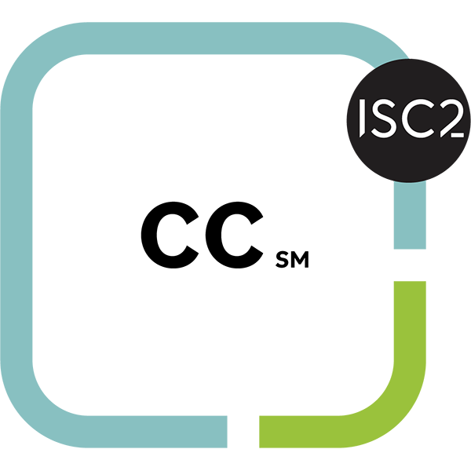

# Welcome to my Cybersecurity Portfolio!

This repository highlights my skills, projects, and accomplishments in Computer Science, with a cybersecurity focus.

---

## Contents:
**[University Projects](./University%20Projects/):**
    - Projects that I have completed as coursework during my time at the University of Birmingham.

**[Software Development and Website Design, Construction, and Management](./University%20Projects/):**
    - Software I have developed, and websites I have built and/or worked on.
    
**[Immersive Labs](./Immersive%20Labs/):**
    - Skills and certifications gained using the Immersive Labs Cyber Security Training platform.

**[Security Architecture and Business Continuity designs](./Security%20Architecture%20and%20Business%20Continuity%20designs/):**
    - Security Architecture designs including:  
        - A fictional data center.
    - These projects highlight my ability to design physical, administrative, and technical security policies.  

---

## About Me:
I am a third year Computer Science student at the University of Birmingham. I have achieved and maintained a 1st class average of 76% across my first two years at university (Y1 78%, Y2 74%), alongside my studies I made use of the university's excellent lecture and talks scheme, and participated in many societies like MMA and CSS. I also play hockey at Edgbaston.

Currently, I work for The Starlight Dance Group Ltd where I head up the IT department and am responsible for maintaining and overseeing all IT operations including all Microsoft 365 applications, and communicating with the client and their website hosting provider, I am also am responsible for maintaining the inventory management system "ChameleonIMS" that I previously developed, during this I've developed many new skills including taking my customer facing skills from miller and carter and adapting them to this role, organising and running client / provider meetings, team work, communication, time management, secure software development, cybersecurity, and IT help desk skills. I also work part time as a Server at Miller and Carter, where I've developed skills in teamwork, communication, and customer service.

Previous to studying at university I completed my A-levels in Maths, Physics, Computer Science (grades A, A, A), and an EPQ (grade B) at Bishop Stopford School Kettering. During my A-levels, I was awarded a scholarship to join the "Future Engineering Leaders" course by Impetus Education Ltd. I also led my school's Sixth Form National Cipher Challenge team and competed in the Cyber Centurion competition run by the US Air Force Association in which as a solo competitor I placed 79th out of close to 300 teams of up to 4 people.

Before A-levels, I earned 9 GCSEs from The Latimer Arts College in 2022 including 7 in Maths and English.

In addition to my studies, I am pursuing my RAD Grade 7 ballet qualification, and have recently completed my RAD Repertoire Level 2 ballet qualification and my RAD Grade 6 ballet qualification.

---

**Certified in Cybersecurity**
--- 

I Also officially recieved my Certified in Cybersecurity (CC) certification from ISC2 in 2025.

This course allowed me to develop and hone my skills in a range of domains including; Access Controls Concepts, Business Continuity (BC) Concepts, Disaster Recovery (DR) Concepts, Incident Response Concepts, Network Security, Security Operations, and Security Principles.

**- Badge**
  

**- Link**  
[CC Qualification](https://www.credly.com/badges/f49da895-e238-46b1-a276-380c8f0feedd/linked_in?t=t43ewi)

---

## Contact Me:
- **Email**: [Email me](mailto:elliothardywork@gmail.com?subject=CyberSecurityPortfolio)  
- **LinkedIn**: [Find me on LinkedIn](https://www.linkedin.com/in/elliot-anthony-hardy/)  
- **Website Portfolio**: [View my personal portfolio website](http://portfolio.elliothardy.com/)
